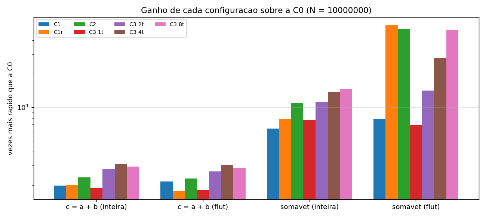
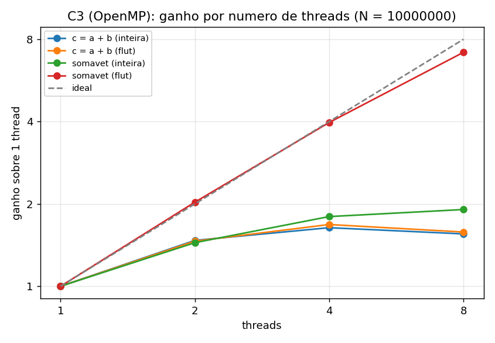

# Núcleos vetoriais em MLIR e estudo de otimização

Este relatório cobre duas coisas: como as operações vetoriais da
linguagem descem de MLIR até LLVM IR, e o que acontece com o tempo e com o
resultado delas em cada configuração de otimização.

Todo número daqui saiu de `make bench` e está em `docs/resultados/`. Para
refazer na sua máquina:

```
make bench
```

---

## 1. Estratégia: híbrida

O programa continua saindo em LLVM IR, pelo gerador do PjBL 3. Só os
núcleos das operações vetoriais saem em MLIR. Depois os dois são juntados:

```
programa.mac ──> ./compilador ──┬──> programa.ll     (LLVM IR, todo o programa)
                                └──> programa.mlir   (MLIR, só os núcleos)

programa.mlir ──> scripts/pipeline.sh ──> nucleos.ll
programa.ll + nucleos.ll ──> llvm-link ──> clang ou lli ou llc
```

Escolhemos a híbrida por três motivos.

- O gerador de LLVM IR já estava pronto e testado. Reescrever tudo em MLIR
  seria refazer o PjBL 3 para ganhar pouco: fora dos vetores, o programa é
  desvio, chamada e conta escalar, que em MLIR desceriam para o mesmo IR.
- O MLIR ajuda exatamente onde existe laço regular sobre vetor. É ali que
  os passos `affine` sabem vetorizar e paralelizar, e é só isso que vai
  para lá.
- Dá para olhar, medir e trocar o núcleo sem mexer no resto. O estudo da
  seção 4 mede o mesmo `.mlir` descido de quatro jeitos, com o programa
  igual.

No programa, `c receba a + b;` vira uma chamada:

```llvm
  ; linha 5: operacao vetorial em 'c'
  %a.base.1 = getelementptr inbounds [1024 x i32], ptr %a.addr, i32 0, i32 0
  %b.base.2 = getelementptr inbounds [1024 x i32], ptr %b.addr, i32 0, i32 0
  %c.base.3 = getelementptr inbounds [1024 x i32], ptr %c.addr, i32 0, i32 0
  call void @nuc_soma_i32_1024(ptr %a.base.1, ptr %b.base.2, ptr %c.base.3)
```

e o `.ll` do programa só declara o núcleo. Existe um núcleo por combinação
de operação, tipo do elemento e tamanho do vetor, e o mesmo núcleo serve
para todas as vezes que aquela combinação aparece.

---

## 2. O mesmo núcleo em cada nível

O núcleo é o da soma de dois vetores de 1024 `inteira`. Os arquivos
completos estão em `docs/resultados/niveis/`, gerados por

```
NIVEIS=docs/resultados/niveis bash scripts/pipeline.sh niveis.mlir niveis.nuc.ll
```

### Nível 1: `affine`, como o compilador gera

```mlir
func.func @nuc_soma_i32_1024(%a: memref<1024xi32>, %b: memref<1024xi32>,
                             %c: memref<1024xi32>)
          attributes { passthrough = ["nounwind"] } {
  affine.for %i = 0 to 1024 {
    %x = affine.load %a[%i] : memref<1024xi32>
    %y = affine.load %b[%i] : memref<1024xi32>
    %z = arith.addi %x, %y : i32
    affine.store %z, %c[%i] : memref<1024xi32>
  }
  return
}
```

Aqui o laço ainda é um laço: tem começo, fim e passo constantes, e todo
acesso ao vetor é uma função simples do contador. É essa informação que
deixa um passo provar que as voltas não dependem umas das outras.

### Nível 2: `scf` e `memref`, depois do `--lower-affine`

```mlir
    %c0 = arith.constant 0 : index
    %c1024 = arith.constant 1024 : index
    %c1 = arith.constant 1 : index
    scf.for %arg3 = %c0 to %c1024 step %c1 {
      %0 = memref.load %arg0[%arg3] : memref<1024xi32>
      %1 = memref.load %arg1[%arg3] : memref<1024xi32>
      %2 = arith.addi %0, %1 : i32
      memref.store %2, %arg2[%arg3] : memref<1024xi32>
    }
```

Preservou: continua sendo um laço estruturado, com o vetor ainda como
`memref` de tamanho conhecido. Descartou: a garantia de que os limites e
os índices são expressões afins. Os limites agora são valores comuns
(`%c0`, `%c1024`), e daqui para baixo nenhum passo `affine` consegue mais
analisar o laço. Por isso vetorizar e paralelizar têm que acontecer antes
deste passo.

### Nível 3: `cf`, depois do `--convert-scf-to-cf`

```mlir
    cf.br ^bb1(%c0 : index)
  ^bb1(%0: index):  // 2 preds: ^bb0, ^bb2
    %1 = arith.cmpi slt, %0, %c1024 : index
    cf.cond_br %1, ^bb2, ^bb3
  ^bb2:  // pred: ^bb1
    %2 = memref.load %arg0[%0] : memref<1024xi32>
    %3 = memref.load %arg1[%0] : memref<1024xi32>
    %4 = arith.addi %2, %3 : i32
    memref.store %4, %arg2[%0] : memref<1024xi32>
    %5 = arith.addi %0, %c1 : index
    cf.br ^bb1(%5 : index)
  ^bb3:  // pred: ^bb1
    return
```

Preservou: as contas e os acessos. Descartou: o laço. Agora são três
blocos e dois desvios, e que isso é um laço virou algo que alguém teria
que redescobrir. O contador virou argumento de bloco (`^bb1(%0: index)`),
que é o jeito do MLIR de escrever o `phi`.

### Nível 4: dialeto `llvm`, ainda MLIR

```mlir
  llvm.func @nuc_soma_i32_1024(%arg0: !llvm.ptr, %arg1: !llvm.ptr, %arg2: !llvm.ptr)
            attributes {passthrough = ["nounwind"]} {
    ...
  ^bb2:  // pred: ^bb1
    %32 = llvm.extractvalue %8[1] : !llvm.struct<(ptr, ptr, i32, array<1 x i32>, array<1 x i32>)>
    %33 = llvm.getelementptr %32[%30] : (!llvm.ptr, i32) -> !llvm.ptr, i32
    %34 = llvm.load %33 : !llvm.ptr -> i32
    ...
    %38 = llvm.add %34, %37  : i32
    ...
    llvm.store %38, %40 : i32, !llvm.ptr
    %41 = llvm.add %30, %29  : i32
    llvm.br ^bb1(%41 : i32)
```

Preservou: a estrutura de blocos. Descartou: o `memref`. O vetor virou um
ponteiro puro e cada acesso virou `getelementptr` mais `load` ou `store`;
o tamanho 1024 só sobrevive como a constante do teste do laço. O tipo
`index` também sumiu e virou `i32`.

### Nível 5: LLVM IR, depois do `mlir-translate`

```llvm
define void @nuc_soma_i32_1024(ptr %0, ptr %1, ptr %2) #0 {
  ...
19:                                               ; preds = %22, %3
  %20 = phi i32 [ %32, %22 ], [ 0, %3 ]
  %21 = icmp slt i32 %20, 1024
  br i1 %21, label %22, label %33

22:                                               ; preds = %19
  %24 = getelementptr i32, ptr %23, i32 %20
  %25 = load i32, ptr %24, align 4
  %27 = getelementptr i32, ptr %26, i32 %20
  %28 = load i32, ptr %27, align 4
  %29 = add i32 %25, %28
  %31 = getelementptr i32, ptr %30, i32 %20
  store i32 %29, ptr %31, align 4
  %32 = add i32 %20, 1
  br label %19
  ...
attributes #0 = { nounwind }
```

É uma tradução um para um do nível 4. O argumento de bloco virou `phi`.
Sai sem `target triple`, sem `datalayout`, com índice `i32` e com
`nounwind`, igual ao IR do resto do programa.

### Os outros dois caminhos, no nível 2

Com `--affine-super-vectorize` antes de descer (modo `vet`), o laço passa
a andar de 8 em 8 e o corpo trabalha com um vetor inteiro por vez:

```mlir
    scf.for %arg3 = %c0 to %c1024 step %c8 {
      %0 = vector.transfer_read %arg0[%arg3], %c0_i32 : memref<1024xi32>, vector<8xi32>
      %1 = vector.transfer_read %arg1[%arg3], %c0_i32_0 : memref<1024xi32>, vector<8xi32>
      %2 = arith.addi %0, %1 : vector<8xi32>
      vector.transfer_write %2, %arg2[%arg3] : vector<8xi32>, memref<1024xi32>
    }
```

Com `--affine-parallelize` (modo `omp`), o laço vira um laço paralelo, que
depois o `--convert-scf-to-openmp` troca por uma região do OpenMP:

```mlir
    scf.parallel (%arg3) = (%c0) to (%c1024) step (%c1) {
      %0 = memref.load %arg0[%arg3] : memref<1024xi32>
      %1 = memref.load %arg1[%arg3] : memref<1024xi32>
      %2 = arith.addi %0, %1 : i32
      memref.store %2, %arg2[%arg3] : memref<1024xi32>
      scf.reduce
    }
```

Os dois passos só conseguem agir no nível 1. É o motivo de os núcleos
serem gerados em `affine` e não direto em `scf`.

---

## 3. O pipeline

Fica em `scripts/pipeline.sh`, com um comentário por passo. Tem três
modos.

| modo      | passos antes de descer                                     | para quê                    |
|-----------|------------------------------------------------------------|-----------------------------|
| `escalar` | nenhum                                                     | `make test`, placa, C0 e C1 |
| `vet`     | `--affine-super-vectorize` (8 elementos, com reduções)     | C2                          |
| `omp`     | `--affine-parallelize` (com reduções), depois OpenMP       | C3                          |

A descida comum é `--lower-affine`, `--convert-scf-to-cf`,
`--convert-arith-to-llvm`, `--finalize-memref-to-llvm`,
`--convert-func-to-llvm`, `--reconcile-unrealized-casts` e por fim
`mlir-translate --mlir-to-llvmir`.

O que tivemos que acertar na versão 18.1.3, em relação ao pipeline de
referência do enunciado:

- **Reduções precisam de opção extra.** `--affine-super-vectorize` só
  vetoriza `somavet` e `prodesc` com `vectorize-reductions=true`, e
  `--affine-parallelize` só paraleliza com `parallel-reductions=1`. Sem
  elas a redução fica escalar e nenhum aviso aparece. E os dois passos só
  reconhecem a redução escrita com `iter_args`, que é como geramos.
- **As opções de um passo vão separadas por espaço.** Com vírgula o
  `mlir-opt` dá erro.
- **`use-bare-ptr-memref-call-conv=1`** faz cada `memref<NxT>` virar um
  ponteiro só no argumento. Sem ela cada vetor vira cinco argumentos
  (dois ponteiros, deslocamento, tamanho e passo). Só funciona com tamanho
  fixo, que é o nosso caso.
- **`index-bitwidth=32`** no modo `escalar` faz o tipo `index` virar
  `i32`. É o que deixa o IR dos núcleos compilável para o AVR. Nos modos
  `vet` e `omp` não dá: os passos de vetor e de OpenMP só trabalham com
  `i64`.
- **`passthrough = ["nounwind"]`** no `func.func` é o que faz a função
  sair com `nounwind` no LLVM IR.
- **OpenMP precisa de `--convert-openmp-to-llvm`** depois do
  `--convert-func-to-llvm`, além do `--canonicalize` que o enunciado cita.
- **`set -o pipefail`** no script. Sem ele, se o `mlir-opt` falha, o
  `mlir-translate` recebe entrada vazia, grava um `.ll` sem função nenhuma
  e sai com 0.

---

## 4. Estudo de otimização

### Máquina e método

```
maquina: AMD Ryzen 9 8945HS w/ Radeon 780M Graphics
nucleos logicos: 16   (8 físicos)
extensoes: sse2 avx avx2 avx512f
Ubuntu clang version 18.1.3, MLIR/LLVM 18.1.3, WSL2 com Ubuntu 24.04
```

- Núcleos medidos: **K1**, `c receba a + b` (elemento a elemento), e
  **K2**, `somavet(a)` (redução). Cada um com `inteira` e com `flut`.
- Tamanhos: 10^6 e 10^7 elementos.
- Os núcleos são os que o nosso compilador gera, a partir de um programa
  em Macaronica com vetores globais do tamanho medido.
- Quem chama e cronometra é `scripts/bench/driver.c`. Só a chamada do
  núcleo fica entre as duas leituras do relógio; alocar e preencher os
  vetores fica fora.
- Antes de medir, o núcleo é chamado por pelo menos 0,2 s para aquecer.
- Cada ponto é a **mediana de 7 execuções**. Mínimo e máximo estão em
  `docs/resultados/resumo.csv`.
- Tempo de compilação é medido à parte, etapa por etapa
  (`compilacao.csv`), e nunca entra no tempo de execução.

| configuração | como é obtida                                                              |
|--------------|----------------------------------------------------------------------------|
| C0           | pipeline `escalar`, `clang -O0`                                            |
| C1           | pipeline `escalar`, `clang -O2 -march=native`                              |
| C1r          | igual à C1, com o programa compilado com `--reordena` (ver seção 5)        |
| C2           | pipeline `vet` (vetorização no MLIR), `clang -O2 -march=native`            |
| C3           | pipeline `omp` (OpenMP), `clang -O2 -march=native -fopenmp=libomp`         |

### Resultados

Mediana do tempo de uma chamada, em milissegundos.

**N = 10^7**

| núcleo              | C0    | C1    | C1r   | C2    | C3 1t | C3 2t | C3 4t | C3 8t |
|---------------------|-------|-------|-------|-------|-------|-------|-------|-------|
| c = a + b (inteira) | 8.984 | 4.554 | 4.469 | 3.829 | 4.769 | 3.242 | 2.913 | 3.069 |
| c = a + b (flut)    | 8.570 | 3.985 | 4.845 | 3.753 | 4.738 | 3.241 | 2.818 | 3.002 |
| somavet (inteira)   | 9.304 | 1.442 | 1.194 | 0.855 | 1.205 | 0.835 | 0.670 | 0.632 |
| somavet (flut)      | 47.2  | 6.064 | 0.865 | 0.931 | 6.784 | 3.342 | 1.709 | 0.947 |

**N = 10^6**

| núcleo              | C0    | C1    | C1r   | C2    | C3 1t | C3 2t | C3 4t | C3 8t |
|---------------------|-------|-------|-------|-------|-------|-------|-------|-------|
| c = a + b (inteira) | 0.822 | 0.194 | 0.175 | 0.178 | 0.162 | 0.103 | 0.059 | 0.050 |
| c = a + b (flut)    | 0.783 | 0.158 | 0.178 | 0.167 | 0.188 | 0.101 | 0.087 | 0.048 |
| somavet (inteira)   | 0.839 | 0.029 | 0.030 | 0.042 | 0.035 | 0.018 | 0.009 | 0.011 |
| somavet (flut)      | 4.370 | 0.606 | 0.033 | 0.079 | 0.644 | 0.308 | 0.163 | 0.084 |





Tempo de construção, mediana por etapa:

| etapa                                  | ms    |
|----------------------------------------|-------|
| `./compilador` (gera `.ll` e `.mlir`)  | 13    |
| `pipeline.sh`, qualquer modo           | 38-42 |
| `clang -O0` nos núcleos                | 30    |
| `clang -O2 -march=native` nos núcleos  | 60-101|

Otimizar custa de 30 a 70 ms a mais de compilação, uma vez, e devolve isso
na primeira chamada do núcleo com vetor grande.

### C0 para C1: o LLVM vetoriza sozinho, mas só se souber o alvo

Na C1 o `clang -O2` vetorizou três dos quatro núcleos. O relatório dele
(`docs/resultados/rpass_C1.txt`):

```
remark: vectorized loop (vectorization width: 16, interleaved count: 4)
remark: vectorized loop (vectorization width: 16, interleaved count: 4)
remark: vectorized loop (vectorization width: 16, interleaved count: 4)
remark: loop not vectorized: cannot prove it is safe to reorder
        floating-point operations; ...
remark: loop not vectorized
```

Largura 16 é o AVX-512 da máquina: 16 `inteira` ou 16 `flut` por
instrução.

Isso depende de o otimizador conhecer o alvo. O nosso IR não tem
`target triple`, de propósito. Rodando `opt -O2` em cima dele, sem e com
alvo (`docs/resultados/vetores_no_ir.txt`):

```
linhas com tipo de vetor no IR dos nucleos (N = 1000000), depois do opt -O2
sem alvo (sem -mtriple):        i32 0     float 0
com alvo (-mcpu=native):        i32 609   float 400
```

Sem alvo, nenhuma linha com tipo de vetor. O modelo de custo não sabe se
vale a pena e desiste. Na C1 quem define o alvo é o próprio `clang`, na
hora de montar.

O ganho da C1 sobre a C0, com N = 10^7, foi de 2,0x a 2,2x no K1 e de
6,5x a 7,8x no K2. Com N = 10^6 chegou a 4,9x no K1 e a 28,6x no K2.

### Por que o K1 para de ganhar em 10^7

Com N = 10^6 o K1 vai de 0,82 ms para 0,19 ms. Com N = 10^7 vai de 9,0 ms
para 4,5 ms e nenhuma configuração passa muito disso: C2 dá 3,8 ms e oito
threads dão 3,1 ms.

O K1 lê dois vetores e escreve um terceiro. Com 10^7 elementos são três
vetores de 40 MB, que não cabem em cache nenhum. O tempo vira o de trazer
120 MB da memória e levar de volta, e somar mais rápido não ajuda quem
está esperando a memória. O K2 lê um vetor só e não escreve nada, e por
isso continua ganhando. É uma hipótese pela forma dos números: não medimos
a banda de memória diretamente.

### C2 contra C1: o que o vetorizador do MLIR fez de diferente

Nos três núcleos que o LLVM já vetorizava, a C2 ficou igual ou um pouco
melhor: 3,8 contra 4,6 ms no K1 de `inteira`, 0,86 contra 1,44 ms no K2 de
`inteira`. Com N = 10^6 ficou igual ou um pouco pior (0,042 contra
0,029 ms no K2 de `inteira`). O vetorizador do MLIR lê e escreve com
máscara (`docs/resultados/mascaras_C2.txt` conta 8 chamadas
`llvm.masked.*` no IR), e isso só não custa caro aqui porque a máquina tem
AVX-512, que faz máscara direto no processador.

A diferença grande é no K2 de `flut`: 6,06 ms na C1 e 0,93 ms na C2. O
MLIR vetorizou a redução de ponto flutuante que o LLVM se recusou a
vetorizar. E fez isso sem pedir permissão a ninguém, mudando o resultado:

| N    | soma certa | C0 e C1 | C2         |
|------|------------|---------|------------|
| 10^6 | 100000     | 100958.344 | 99910.3203 |
| 10^7 | 1000000    | 1087937    | 1010791.88 |

Então a resposta à pergunta "o MLIR fez algo que o LLVM não fez" é sim, e
vem com um aviso: o `--affine-super-vectorize` com
`vectorize-reductions=true` reordena soma de `flut` por conta própria. O
LLVM, na mesma situação, só reordena se a instrução disser que pode. A
seção 5 mostra o caminho com permissão.

### C3: paralelismo

O K2 de `flut` é o que mais escala, porque na C3 ele ainda é o núcleo
mais lento por thread:

| threads | K2 flut, N = 10^7 | ganho sobre 1 thread |
|---------|-------------------|----------------------|
| 1       | 6,784 ms          | 1,0x                 |
| 2       | 3,342 ms          | 2,0x                 |
| 4       | 1,709 ms          | 4,0x                 |
| 8       | 0,947 ms          | 7,2x                 |

Quase linear até os 8 núcleos físicos. O K2 de `inteira` vai de 1,205 para
0,632 ms (1,9x) e o K1 de 4,8 para 3,1 ms (1,6x): os dois já estavam
perto do limite da memória com uma thread só, e mais threads brigam pela
mesma memória.

Três observações medidas:

- Com uma thread a C3 é um pouco mais lenta que a C1 (4,77 contra 4,55 ms
  no K1). É o custo de criar a região paralela.
- A redução paralela também muda a soma de `flut`, e muda diferente para
  cada número de threads, porque cada thread soma um pedaço e os pedaços
  são juntados no fim: 956549.562 com 2 threads, 975599.125 com 4,
  1010791.75 com 8, para a soma certa de 1000000.
- O IR da C3 não segue as regras do IR portável: ele chama
  `__kmpc_fork_call`, que é variádica, e usa `i64`. Por isso a C3 existe só
  no estudo. O programa de verdade e a placa usam o modo `escalar`.

Não medimos com 16 threads. A máquina tem 8 núcleos físicos, e dentro do
WSL as medidas com todos os núcleos lógicos ocupados variam demais para
valer como dado.

---

## 5. Por que a redução de `flut` não vetoriza sozinha

### A resposta

Vetorizar uma soma é trocar a ordem em que os números são somados. Em vez
de `((a0 + a1) + a2) + a3 ...` em fila, o processador mantém várias somas
parciais ao mesmo tempo, uma por posição do registrador, e junta todas no
fim.

Com `inteira` isso é sempre permitido. A soma de inteiros em complemento
de dois é associativa, inclusive quando estoura: qualquer ordem dá
exatamente os mesmos 32 bits.

Com `flut` não é. Cada soma de ponto flutuante arredonda o resultado para
caber em 24 bits de mantissa, e o arredondamento depende do tamanho dos
dois números somados. Então `(a + b) + c` e `a + (b + c)` podem dar
resultados diferentes. Soma de ponto flutuante não é associativa, e trocar
a ordem troca o resultado. Um compilador não pode mudar o resultado do
programa por conta própria, então o LLVM não vetoriza. É o que o relatório
dele diz, com todas as letras:

```
loop not vectorized: cannot prove it is safe to reorder floating-point operations
```

### A verificação

O compilador tem a opção `--reordena`. Com ela, as somas das reduções de
`flut` e `duplocarpado` saem no MLIR com a marca que dá a permissão:

```mlir
    %n = arith.addf %acc, %x fastmath<reassoc> : f32
```

que desce para o LLVM IR como

```llvm
  %15 = fadd reassoc float %9, %14
```

É a única diferença entre a C1 e a C1r. O resto do programa, o pipeline e
os comandos do `clang` são iguais.

**O relatório do vetorizador muda** (`rpass_C1r.txt`): os quatro laços
vetorizam, e a mensagem de "cannot prove" some.

**O IR muda** (`ir_somavet_f32_C1r.ll`). A redução passa a usar quatro
acumuladores de 16 `flut` cada:

```llvm
  %vec.phi  = phi <16 x float> [ ..., %vector.ph ], [ %221, %vector.body ]
  %vec.phi2 = phi <16 x float> [ ..., %vector.ph ], [ %222, %vector.body ]
  %vec.phi3 = phi <16 x float> [ ..., %vector.ph ], [ %223, %vector.body ]
  %vec.phi4 = phi <16 x float> [ ..., %vector.ph ], [ %224, %vector.body ]
  ...
  %5 = fadd reassoc <16 x float> %vec.phi, %wide.load
  %6 = fadd reassoc <16 x float> %vec.phi2, %wide.load5
```

São 4 x 16 = 64 somas parciais andando ao mesmo tempo.
`vetores_no_ir.txt` mostra o mesmo de outro jeito: as linhas com
`<16 x float>` passam de 400 para 609.

**O tempo muda.** Com N = 10^7, de 6,064 ms para 0,865 ms: **7,0 vezes
mais rápido**. Com N = 10^6, de 0,606 para 0,033 ms.

**O resultado muda.** O vetor tem 10^7 elementos, todos `0.1`:

| como soma                         | resultado     | erro    |
|-----------------------------------|---------------|---------|
| conta exata                       | 1000000       |         |
| em fila (C0, C1)                  | 1087937       | +8,8%   |
| 64 somas parciais (C1r)           | 998501.375    | -0,15%  |

O curioso é que a versão reordenada erra menos. O motivo é o mesmo
arredondamento. Somando em fila, o acumulador único cresce até perto de
um milhão. Nessa faixa um `flut` só consegue representar números de
0,0625 em 0,0625, então cada `+ 0.1` é arredondado para `+ 0.125`, sempre
para cima, e o erro acumula milhões de vezes na mesma direção. Com 64
acumuladores, cada um só chega perto de 15625, onde o `flut` anda de
0,001 em 0,001, e o `0.1` entra quase inteiro.

Isso não quer dizer que reordenar seja mais correto. Quer dizer que o
resultado depende da ordem, que é exatamente o motivo de o compilador não
poder escolher a ordem sozinho.

### A flag do `clang` não resolve

O relatório do LLVM sugere `-ffast-math`. Testamos em cima do nosso `.ll`
(`rpass_C1_ffast_math.txt`):

```
clang-18 -O2 -march=native -ffast-math -Rpass=loop-vectorize ... -c esc_1000000.ll
remark: loop not vectorized: cannot prove it is safe to reorder floating-point operations
```

Continua sem vetorizar. A `-ffast-math` muda o que o `clang` escreve
quando ele traduz C. No nosso caso o IR já está pronto, e a permissão mora
em cada instrução (`fadd reassoc`). Quem tem que escrever a marca é quem
gera o IR, ou seja, o nosso compilador. Por isso a decisão virou uma opção
dele, e desligada por padrão: sem `--reordena` o programa dá sempre o
mesmo resultado, em qualquer configuração do modo `escalar`.

---

## 6. Resumo do que os dados mostram

| pergunta                                         | resposta medida                                         |
|--------------------------------------------------|---------------------------------------------------------|
| O LLVM vetoriza os núcleos sozinho?              | 3 de 4, com alvo definido. Sem alvo, nenhum.            |
| Qual ele não vetoriza?                           | A redução de `flut`, por causa da ordem da soma.        |
| O vetorizador do MLIR faz diferença?             | Só na redução de `flut` (6,5x), e muda o resultado.     |
| Dar a permissão no IR resolve?                   | Sim: 7,0x mais rápido, e o resultado muda de 1087937 para 998501.375. |
| `-ffast-math` no `clang` resolve?                | Não, com o IR já pronto.                                |
| Paralelizar escala?                              | A redução de `flut`, 7,2x com 8 threads. O K1 quase nada. |
| Qual é o limite do K1 em 10^7?                   | Perto de 3 ms em qualquer configuração (memória).       |
